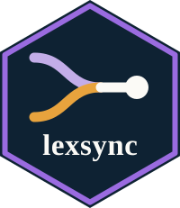

# lexsync 

<!-- badges: start -->
[](https://CRAN.R-project.org/package=lexsync)
[](https://pypi.org/project/lexsync/)
[](https://github.com/pablobernabeu/lexsync/actions/workflows/R-CMD-check.yaml)
[](https://github.com/pablobernabeu/lexsync/actions/workflows/python-tests.yaml)
[](https://lifecycle.r-lib.org/articles/stages.html#experimental)
[](https://opensource.org/license/MIT)
[](https://doi.org/10.5281/zenodo.22906962)
<!-- badges: end -->

Lexical optimisation and hardware-timed experiment generation, in
R and Python.

`lexsync` is a cross-platform toolkit for building psycholinguistic stimulus sets
and the experiments that present them. It is distributed as two structurally
identical, independently installable packages, an R package on CRAN and a Python
package on PyPI. From a word-frequency corpus in any of dozens of languages, it
selects stimuli matched in parallel across several lexical dimensions (length,
frequency, orthographic neighbourhood density and more) and counterbalances them
across conditions and lists. It then generates the presentation experiment for
'PsychoPy', 'OpenSesame' or the browser ('jsPsych'). The laboratory targets carry
hardware triggers injected at stimulus onset for EEG/ERP synchronisation. The web
target is a single shareable HTML file that loads the 'jsPsych' library from a CDN,
so the machine running it needs an internet connection.

The trial is described declaratively as a sequence of events, so the same engine
builds factorial word studies, lexical decision with deterministically generated
pseudowords, priming, self-paced reading and cued categorisation from configuration
alone. The engine handles word, pseudoword, paired and sentence stimuli, as well as
practice and filler blocks that run but are not analysed.

Beyond matching, `lexsync` treats the stimulus set as a reproducible research
artefact. Every run is deterministic and seeded, and writes a machine- and
human-readable materials datasheet with its provenance, checksums, the realised
control (effect size, confidence interval and equivalence test) and a
pre-registration skeleton.

## Documentation

The documentation for both packages is published at
[pablobernabeu.github.io/lexsync](https://pablobernabeu.github.io/lexsync/):

- R package (pkgdown): <https://pablobernabeu.github.io/lexsync/r/>
- Python package (mkdocs): <https://pablobernabeu.github.io/lexsync/python/>

Each site carries the function reference alongside guides to matching and designs,
to experiments and triggers, and to reproducibility and parity. Every worked design
in this repository is also published beside the documentation as a browser
experiment. The [lexical-decision
demonstration](https://pablobernabeu.github.io/lexsync/demos/en_lexdec_english.html)
runs with nothing to install.

## Why lexsync

Existing tools each cover part of the workflow. Stimulus-control packages such as
'LexOPS', 'LIBRA' and 'LASTU' match words but do not build the experiment, while
experiment builders such as 'PsychoPy' and 'OpenSesame' present stimuli but do not
match them. Few tools work in both R and Python, and most matching tools target a
single language. `lexsync` covers the whole workflow in both languages, from a
many-language corpus through parallel multidimensional matching and counterbalancing
to flip-locked, cross-platform experiment scripts. The 'PsychoPy' backend binds each
onset trigger to the buffer flip on which the stimulus appears, using
`win.callOnFlip`, rather than sending it from a later, sequence-ordered item.

Under the two deterministic matching methods, the two engines select byte-identical
stimuli, deal them into the same lists and conditions, and order the trials
identically, so the generated experiment files match byte for byte. Nothing in the
package draws a random number. A seeded shuffle gives the same trial order in both
languages because the order comes from a keyed hash of the design and the seed.

## Repository layout

The two packages sit side by side, with the corpora, configurations, item tables and
generated output they share held at the root:

```
lexsync/
├── R_workflow/        R package 'lexsync', published on CRAN
├── python_workflow/   Python package 'lexsync', published on PyPI
├── corpora/           many-language corpus registry + ingestion + attribution
├── config/            global schema + per-design configurations
├── items/             example item tables (priming pairs, SPR sentences)
├── templates/         experiment script templates (PsychoPy, OpenSesame, jsPsych)
├── output/            generated stimuli, reports and experiment scripts
├── parity/            edge-case designs whose outcome both engines must reproduce
├── tools/             engine comparison and twin-edge maintenance scripts
└── apps/              browser apps (Streamlit + Shiny) that export reproducible code
```

Both packages expose parallel modules, including `querying`, `matching`,
`counterbalancing`, `scripting`, `validation`, `logging` and `corpora`, and the same
orchestrator, `run_pipeline`.

## Quick start

The two blocks below run the bundled demonstration designs from a checkout of this
repository, writing the matched stimuli, the reports and the generated experiments
into `output/`. Either engine produces the same result, so run whichever language
you work in.

In R:

```bash
Rscript -e "chooseCRANmirror(ind = 1); install.packages(c('readr','yaml','stringdist','stringi','jsonlite','digest'))"
# from the repository root:
Rscript R_workflow/run_pipeline.R             # runs the demonstrations
# or, once installed (choose an output path):
Rscript -e "lexsync::run_pipeline('config/design_en_freqcontrast.yaml', outdir = 'my-output')"
```

In Python:

```bash
python -m pip install -e "python_workflow[dev]"
python python_workflow/run_pipeline.py        # runs the demonstrations
# or, once installed:  lexsync run config/design_en_freqcontrast.yaml
```

The R line above installs that package's required dependencies. One matching method,
`optimal`, additionally needs `clue` for its assignment solver. The Python engine
solves the same assignment problem with `scipy`'s `linear_sum_assignment`, and `scipy`
is among its required dependencies.

`R_workflow/run_pipeline.R` runs the installed lexsync when there is one and the
sources under `R_workflow/R` otherwise, and its start-up message says which. A release
installed from CRAN can predate this checkout's designs and select differently, so
install the checkout's package
(`install.packages("R_workflow", repos = NULL, type = "source")`) or remove the
installed one before running the demonstrations.

To install the packages themselves rather than run them from a checkout, see
[`R_workflow/README.md`](R_workflow/README.md) and
[`python_workflow/README.md`](python_workflow/README.md). The R package is published
on [CRAN](https://CRAN.R-project.org/package=lexsync) and installs with
`install.packages("lexsync")`. The Python package is published on
[PyPI](https://pypi.org/project/lexsync/) and installs with `pip install lexsync`.

Neither the generation step nor its tests require 'PsychoPy', 'OpenSesame' or any
parallel-port driver. These are needed only when the generated experiment is run on
hardware.

## Web apps

Two browser front-ends in `apps/` let a researcher assemble a design without writing
code, run the pipeline and view the matched stimuli, the realised-control report and
the materials datasheet. A Streamlit app wraps the Python engine and a Shiny app
wraps the R engine, and the two select byte-identical stimuli under the deterministic
matching methods, which include the default. Each one also exports the design
configuration and the one-line R, Python and command-line code that reproduces the
operation. See `apps/README.md` for details.

```bash
streamlit run apps/python_streamlit/lexsync_app.py             # Python
Rscript -e "shiny::runApp('apps/r_shiny', port = 8502)"        # R
```

## Corpora

Languages are supplied through `corpora/registry.yaml`, which documents two
connectors: a curated SUBTLEX-family/'openlexicon' connector (individually citable
corpora under CC BY-SA 4.0) and a 'wordfreq' connector with thirty registered
languages ('wordfreq' covers 42). English, Spanish and Mandarin Chinese are bundled
and demonstrated, and the Mandarin Chinese example shows that matching and
experiment generation also work with a logographic script.

The three bundled corpora come from 'wordfreq', not from the 'openlexicon'
connector, and carry its CC BY-SA 4.0 data terms. They are not screened for lexical
status, so they hold proper names, acronyms and other forms that are not words of
the language, and `corpora/ATTRIBUTION.md` measures the extent. The repository's
`corpora/derived/en_v2.csv` marks those forms in the English lexicon, and the
English demonstrations and the packages' English example slices draw only on the
forms it leaves unmarked.

`normalise_lexicon()`, in both packages, turns a corpus file in its publisher's
layout into a lexicon that `load_lexicon()` reads. It reads a tab- or
comma-separated file, renames its columns by the registry's `columns` map,
converts a frequency per million with Zipf = log10(per million) + 3 and puts the
words in lower case and Unicode NFC. `normalise_lexicon(path, entry =
"subtlex_uk")` does this for a SUBTLEX-UK file downloaded from its own page.
`fetch_corpus()` downloads an entry that registers a delimited file, checks its
SHA-256 and normalises it the same way. SUBTLEX-US is the first such entry, so
`fetch_corpus("subtlex_us")` gives either package SUBTLEX-US as a lexicon.

Only the Python package builds lexica for the 'wordfreq' languages. `lexsync fetch
<language> --n-words <N>` derives a lexicon of N forms, 10,000 by default, into a
user cache, and the R package can read the result as an ordinary corpus. The
committed `en.csv`, `es.csv` and `zh.csv` in `corpora/derived/` were built with
`python corpora/fetch_corpora.py --languages en es --n-words 30000` and, for
Chinese, `--languages zh --n-words 20000`. `--screen-en` builds `en_v2.csv` from
`en.csv` and a SUBTLEX-US copy whose checksum it verifies, `--known-forms en es`
writes the known-form lists and `corpora/build_es_gender.py` derives `es_gender.csv`
from `es.csv`. Every committed corpus is cited, with its licence and retrieval date,
in `corpora/ATTRIBUTION.md`.

The bundled corpora are a fixed, checksummed snapshot, so the demonstrations
reproduce with no download. Corpora fetched through 'wordfreq' are reproducible as
well, because 'wordfreq' was frozen in 2024 and gives a stable snapshot of usage
through roughly 2021.

## Extending lexsync

Each extension point needs the same edits in both engines.

To add a paradigm, add an entry to the `PARADIGMS` registry in
`R_workflow/R/paradigms.R` and `python_workflow/src/lexsync/paradigms.py`, giving its
default trial-event sequence, required fields and counterbalancing recipe. The
two engines then render it with no further code. Both test suites check a digest of
the registry against a stored value (`python_workflow/tests/test_masked_priming.py`
and `R_workflow/tests/testthat/test-masked-priming.R`), so update that value in both.

To add a lexical dimension computed against the reference lexicon, add the
computation in `R_workflow/R/querying.R` and `python_workflow/src/lexsync/querying.py`,
alongside `add_neighbourhood()` and `add_bigram_frequency()`. Have the pipeline
derive it through `.DERIVED_DIMS` and `.derive_dims()` in `R_workflow/R/run_pipeline.R`
and `DERIVED_DIMS` and `_derive_dims()` in `python_workflow/src/lexsync/run_pipeline.py`.
A corpus or pool design reports the dimension when the design matches on it or
defines a condition by it. Adding the dimension to `.REPORT_DIMS` and
`REPORT_DIMS`, in the same two files, puts it in the report of every matched corpus
or pool design whose stimuli carry it. Then list it, with its unit, under
`dimensions` in `config/schema.yaml` and in its two bundled copies,
`R_workflow/inst/extdata/schema.yaml` and `python_workflow/src/lexsync/data/schema.yaml`,
which must stay byte-identical to it. Every committed datasheet records the schema's
SHA-256, so regenerate `output/` with both engines. A dimension that comes from a norm
table needs no code: name the table under a design's `norms`.

To add a presentation target, add an `export_<target>()` function in
`R_workflow/R/scripting.R` and `python_workflow/src/lexsync/scripting.py` that walks
the same rendered event list, and call it from `export_experiments()` in both files.

Adding a corpus is a registry entry in `corpora/registry.yaml` and in the copies the
packages bundle, `R_workflow/inst/extdata/registry.yaml` and
`python_workflow/src/lexsync/data/registry.yaml`, which they read outside a checkout.
Making it downloadable needs a delimited-file URL and its SHA-256.

## Tests and continuous integration

The R package carries a `testthat` suite and the Python package a `pytest` suite.
The `pytest` suite includes a mock-'PsychoPy' harness that checks the onset trigger
is flip-locked, a structural validator for the generated 'OpenSesame' experiment and
an R-versus-Python parity test. GitHub Actions run `R CMD check` on Ubuntu, macOS
and Windows under the current R release, on Ubuntu and Windows under R-devel and on
Ubuntu under the previous release. They run the Python tests on Python 3.10–3.14.

## Matching methods

Four matching methods are available, set with `matching.method` in a design. The
default, `standardised_euclidean`, is greedy nearest-neighbour matching on z-scored
dimensions. `joint` is greedy pairing for a two-condition design, closest pairs
first. `mahalanobis` uses a covariance-aware distance that down-weights correlated
dimensions (Rubin, 1980; Stuart, 2010). `optimal` selects the n pairs of least
summed distance for two conditions by solving a padded assignment problem exactly
(Volgenant, 2004).

The R and Python engines select byte-identical stimuli for `standardised_euclidean`
and `joint`. The `mahalanobis` and `optimal` methods are not guaranteed
byte-identical across engines, because they use a covariance-matrix inverse and an
assignment solver whose last bits can differ between the two linear-algebra
backends. `mahalanobis` usually still agrees exactly, while `optimal` selects an
equally-optimal but often different set. Each run's datasheet records which case
applies.

## Continuous designs

A design may replace its discrete `conditions` with a `continuous:` block,
naming a predictor and its controls. lexsync then spreads the selection over the
predictor's ranks in the pool, so the set follows the pool's distribution of the
predictor, while tolerance windows trim the controls' tails without holding them
constant. The set is ready for analysis by regression or a mixed model
(Kuperman, 2015; Liben-Nowell et al., 2019). The datasheet reports the
predictor's span, the predictor-control correlations and a suggested regression
model. The two engines select byte-identical stimuli. See
`config/design_en_freqcontinuous.yaml`.

## Pseudoword generation

The lexical-decision paradigm generates a length-matched pseudoword for each word.
Two methods are available via `items.generation.method`. The default,
`letter_substitution`, changes the fewest single letters while keeping every bigram
attested. `subsyllabic` splits each word into onset/nucleus/coda constituents and
swaps whole constituents for attested same-role, same-length alternatives, so the
pseudowords keep their syllabic structure. It is a deterministic orthographic
approximation of Wuggy (Keuleers & Brysbaert, 2010). Both methods select
byte-identical stimuli across the two engines. See
`config/design_en_lexdec_wuggy.yaml`.

## Roadmap

lexsync sits within an established ecosystem of stimulus tools: LexOPS, Match, SOS
and LIBRA for matching, and Wuggy for pseudowords. Beside them, it offers
covariance-aware and optimal matching, a distributional balance diagnostic,
continuous designs and Wuggy-style pseudowords. Further norm dimensions, such as
concreteness, age of acquisition and English Lexicon Project behavioural measures,
are supported today through the `merge_norms` connector, which joins any word-keyed
norm table so the matcher can equate on it.

Future directions, tracked in `CHANGELOG.md`, are more bundled languages and, should
a determinism-safe implementation be found, promoting a covariance-aware distance to
the default. The cross-engine byte-identical guarantee for the deterministic methods
is a hard constraint on which algorithms can be adopted as defaults.

## Citation

If you use `lexsync`, please cite the software. The authoritative record is
[`CITATION.cff`](CITATION.cff), which GitHub renders into several formats through its
'Cite this repository' button. Each package's About page carries a formatted
reference. The one for the R package gives the DOI that CRAN assigned on publication,
<https://doi.org/10.32614/CRAN.package.lexsync>. PyPI assigns no DOI, so the one for
the Python package gives the concept DOI of the Zenodo archive,
<https://doi.org/10.5281/zenodo.22906962>, which holds every GitHub release of both
packages. `CITATION.cff` describes both packages, so it gives the Zenodo DOI and
lists each package's identifiers. A manuscript describing lexsync is in preparation.

Cite the corpus as well as the software. The corpora are third-party work with their
own terms, and each is credited, with its licence and retrieval date, in
[`corpora/ATTRIBUTION.md`](corpora/ATTRIBUTION.md). Each run's datasheet records which
source file it read, and its SHA-256.

## Licence

The source code is under the MIT licence ([`LICENSE`](LICENSE)). The bundled corpus
derivatives are released under CC BY-SA 4.0 instead, as recorded in
[`LICENSE-DATA`](LICENSE-DATA).

## Contributing

Issues and pull requests are welcome, on the [issue
tracker](https://github.com/pablobernabeu/lexsync/issues). A report that includes the
design YAML and the run log can be acted on, because together they record the inputs
and every step that ran.

## References

Keuleers, E., & Brysbaert, M. (2010). Wuggy: A multilingual pseudoword generator.
*Behavior Research Methods*, *42*(3), 627–633. https://doi.org/10.3758/BRM.42.3.627

Kuperman, V. (2015). Virtual experiments in megastudies: A case study of language
and emotion. *Quarterly Journal of Experimental Psychology*, *68*(8), 1693–1710.
https://doi.org/10.1080/17470218.2014.989865

Liben-Nowell, D., Strand, J., Sharp, A., Wexler, T., & Woods, K. (2019). The danger
of testing by selecting controlled subsets, with applications to spoken-word
recognition. *Journal of Cognition*, *2*(1), Article 2. https://doi.org/10.5334/joc.51

Rubin, D. B. (1980). Bias reduction using Mahalanobis-metric matching. *Biometrics*,
*36*(2), 293–298. https://doi.org/10.2307/2529981

Stuart, E. A. (2010). Matching methods for causal inference: A review and a look
forward. *Statistical Science*, *25*(1), 1–21. https://doi.org/10.1214/09-STS313

Volgenant, A. (2004). Solving the *k*-cardinality assignment problem by
transformation. *European Journal of Operational Research*, *157*(2), 322–331.
https://doi.org/10.1016/S0377-2217(03)00205-4
